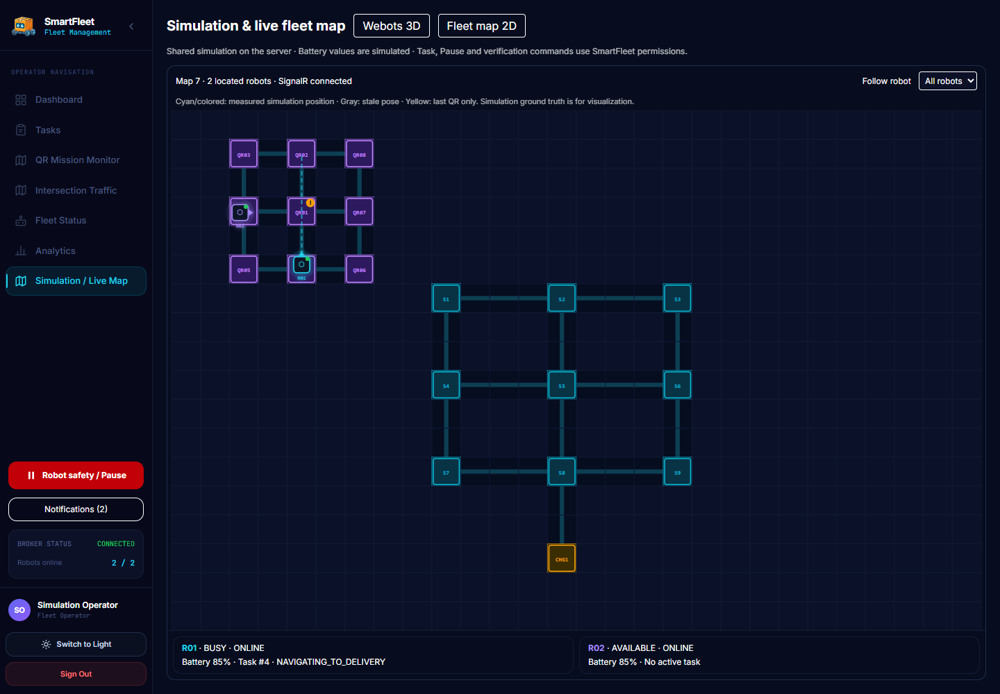
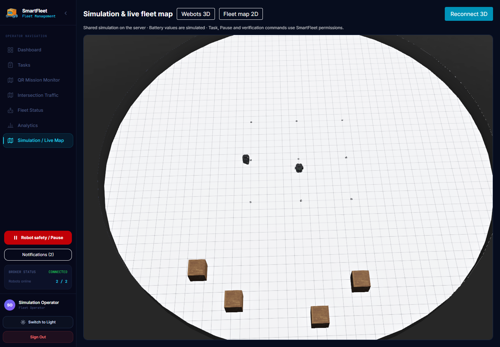
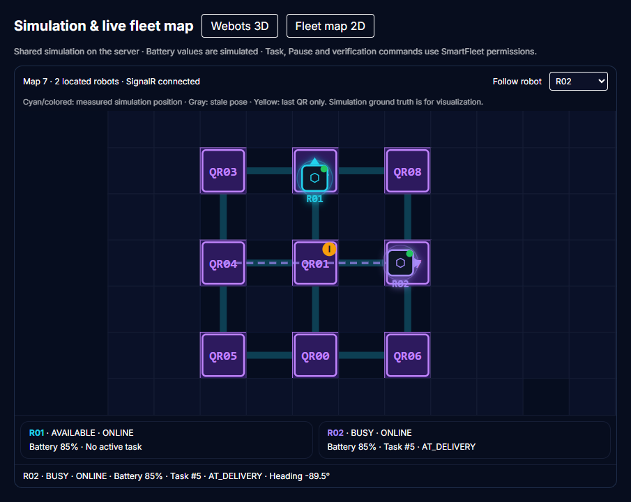

# Simulation validation — 25 November 2026

Validated on Windows Docker Desktop using Linux containers and Webots R2025a.
Validated changes are maintained on `feat/task-cancellation`.

| Check | Result |
|---|---|
| Backend automated suite | 114 passed |
| Python protocol/localization/safety suite | 35 passed |
| Playwright UI regressions, including all three roles | 26 passed |
| TypeScript, production frontend build, Compose build/config | Passed |
| Two robots, AUTO dispatch, shared intersection, FE07 pickup/delivery | Both missions completed |
| Independent clean source directory without private appsettings, node_modules or host Webots | Built, seeded a fresh DB, both missions completed |
| Final image: one additional mission plus visible moving SVG robot | Completed; measured DOM coordinates changed |
| Two independent authenticated browser sessions viewing the same 3D world | Passed |
| Browser Reset/Pause/run commands | Discarded; pose sequence continued and world run ID stayed unchanged |
| Save marker geometry, reject assignment while incompatible, restore map | Passed; PostgreSQL revision 7 confirmed after backend restart |
| Anonymous viewing, arbitrary upstream files, Maintenance map edits/scan commands | Rejected |

The five completed missions used real Webots camera/IMU control, actual MQTT/backend/PostgreSQL traffic, and test-harness operator transfer confirmations. Each two-robot run persisted four verifications. Wrong station QR was rejected before accepting the correct confirmation. Position from the Supervisor was used only for visualization.

The container-specific failures found during testing were corrected: Python 3.10 parsing of .NET timestamps, route refresh while waiting without dropping an entered intersection reservation, Qt HTTP/2 asset downloads, and R2025a broadcast-viewer mesh paths and unsolicited load-time Pause commands. The viewer gateway also excludes robot editor windows and only serves commissioned image assets.

This verifies a clean-source installation on this host, not every operating system. The two browser contexts used the host's LAN IP; no second physical device has been verified. Remote access depends on the host firewall and LAN configuration. Battery remains a simulated 85%; physical hardware, production internet hosting and multiple backend instances were not validated.

Raw summarized evidence: [simulation-validation-2026-11-25.json](simulation-validation-2026-11-25.json). Setup: [simulation-deployment.md](simulation-deployment.md).

## Follow-up: MANUAL assignment and dialog contrast

The original real-mission runs used AUTO dispatch. A subsequent operator test exposed a PHYSICAL-only check still present in MANUAL confirmation even though the list admitted SIMULATION robots. Listing, MANUAL confirmation and AUTO now share one type policy; outside simulation the default remains PHYSICAL. The follow-up backend suite passes 114 tests, including the type/dispatch-mode matrix.

Native dialog foreground color also overrode inherited theme text. Task dialogs now explicitly inherit the application's foreground, with readable hint text in dark and light themes. The full UI suite passes 26 tests, including computed contrast checks and screenshots for Create/Assign dialogs.

An isolated PostgreSQL/MQTT/Webots run manually assigned R02 from QR4 to QR7 and completed both FE07 confirmations and the mission. The user's queued T005 was preserved; updated frontend/backend images were deployed to port 8080 without restarting the user's Webots container.

## Follow-up: larger QR tracking map

The live map now focuses on the nine QR checkpoints, with larger labels and robot markers. The legacy S1–S9/CHG1 drawing is hidden from tracking; the database map and map editor remain intact. TypeScript, production build and seven map/simulation regressions passed. Actual browser checks at 1440×900 and 1125×720 confirmed all nine QR labels, no legacy station labels, robot selection, and unchanged saved map revision 7.

